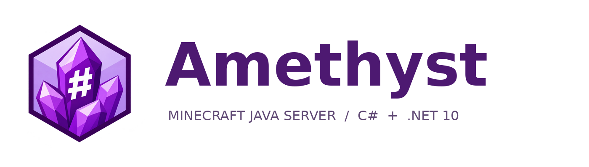

<p align="center"></p>

<p align="center"><strong>An open-source Minecraft Java Edition server written from scratch in C# and .NET 10, featuring procedural world generation and a custom server engine.</strong></p>

<p align="center"><em>Experimental · Minecraft Java Edition 26.3 · protocol 777 · .NET 10</em></p>

## Overview

**Amethyst** is an independent, experimental Minecraft Java Edition server implementation written in C# on .NET 10. It aims to deliver Minecraft-compatible multiplayer with its own deterministic, vanilla-inspired world generator. It is **not** a fork of the Minecraft server, nor is it production ready.

Current functionality includes:

- Server-list status and ping; authenticated Mojang account login using RSA/AES-CFB8.
- Configuration and Play states for Java Edition 26.3 (protocol 777).
- Basic multiplayer movement, rotation and other-player synchronization.
- Custom seeded terrain (continents, mountains, density caves, aquifers, biomes), trees, ores and small structures.
- Chunk streaming with acknowledged batches, background workers, performance counters and bounded caches.
- In-game text chat (currently system messages), operator permissions, `/gamemode` and the native game-mode switcher.
- Day/night cycle, static chunk lighting, YAML configuration and persisted generated worlds.
- An interactive server console with log-safe input, history, completion and a `perf` command.
- **Shards plugin runtime** with lifecycle hooks, dependency/capability resolution, service API, packet hooks and command registration.
- Three enabled built-in Shards: Overworld (generation/chunks/lighting), Items (all 1,658 Java 26.3 item definitions and stack-size rules), and Gameplay (players/inventory/workstations/chat/permissions/time). A disabled Hello example Shard demonstrates the plugin API.
- Experimental **Creative and Survival block interaction**: tool-aware timed mining, physical ground item drops and pickup into persistent inventories, stack-consuming placement, per-chunk edit persistence and multiplayer block updates. No complete loot/physics or dynamic client relighting yet.
- **Player location persistence:** each player's last valid coordinates and facing are saved per world on disconnect and every 15 seconds; reconnect restores the camera location before chunk streaming. Invalid/world-mismatched saves return to world spawn.
- **Workstation menus (experimental):** crafting tables open a real 3×3 crafting window with server-validated ingredient/output clicks; furnaces, smokers, and blast furnaces have working fuel, cooking progress, shared inventories, and persistent contents. Includes a starter subset of vanilla 26.3 recipes; recipe-book automation, XP, and advanced stations are not yet supported.

> **Status:** Prototype. No claim of full vanilla gameplay, complete Survival mechanics, signed chat verification, or production-grade compatibility. Local building and in-game testing are still required for this snapshot.

## Requirements

- [.NET 10 SDK](https://dotnet.microsoft.com/download/dotnet/10.0)
- A Minecraft **Java Edition 26.3** client with an authenticated Java account
- Internet access on first run for the version-pinned vanilla registry tag payload

## Get started

```bash
git clone https://github.com/FredyJabe/Amethyst.git
cd Amethyst
dotnet build Amethyst.slnx
dotnet run --no-build --project src/Amethyst.csproj -- server.yaml
```

Alternatively, on Linux/macOS use `./run.sh` (run `chmod +x run.sh` if needed); it builds the kernel and Shards before running. See [Shard API and development guide](SHARDS.md). The default `server.yaml` listens only on `127.0.0.1:25565` and has `onlineMode: true`. Adjust the bind address only after reviewing authentication and server security.

The world seed, generator version, default game mode (`defaultGameMode: survival` or `creative`), lighting, console, and chunk performance options live in `server.yaml`; the sensitive operator list lives in ignored `ops.yaml`. Generated world data under `worlds/` is also ignored.

```yaml
operatorsFile: "ops.yaml"  # runtime operator list (ignored by Git)
```

### First operator

Join using an authenticated Java account, then in the **server terminal** run:

```text
op YourPlayerName 4
```

Operators are saved by verified Mojang UUID. Commands include `help`, `list`, `say`, `op`, `deop`, `kick`, `oplist`, `perf`, `clear`, and `stop` (some commands require elevated permissions).

## Tests

```bash
dotnet build Amethyst.slnx
for project in tests/*/*.csproj; do dotnet run --project "$project"; done
for test in tests/test_*.py; do python3 "$test"; done
```

Python tests require PyYAML. `tests/probe.py` is a separate network probe that requires a running server. `tests/PerformanceTests` also accepts `-- --bench` for an optional benchmark.

## Documentation

- [Shards plugin API and runtime](SHARDS.md)
- [Chunk performance and tuning](PERFORMANCE.md)
- [Technical implementation details](docs/development-notes.md)
- [Third-party data acknowledgments](THIRD_PARTY_NOTICES.md)
- [Contributing](CONTRIBUTING.md)

## Disclaimer

Amethyst is a community-created, unofficial project, not affiliated with, sponsored by, or endorsed by Mojang Studios or Microsoft. **Minecraft** is a trademark of its respective owners. No Minecraft game assets or server binaries are included.

## License

MIT — see [LICENSE](LICENSE). The project also uses version-specific registry metadata and downloads a separately attributed vanilla tag payload at runtime; see [THIRD_PARTY_NOTICES.md](THIRD_PARTY_NOTICES.md).
